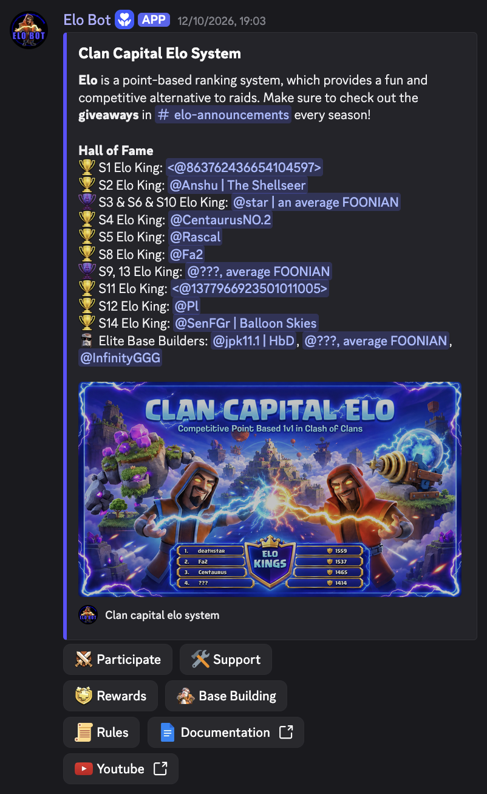
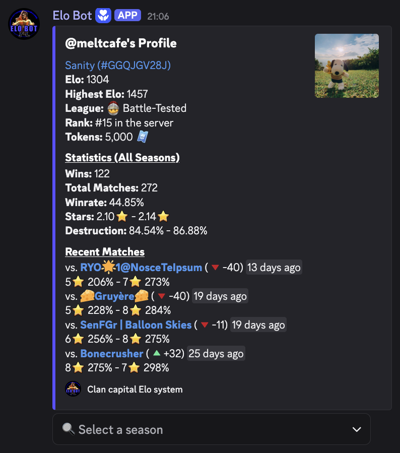
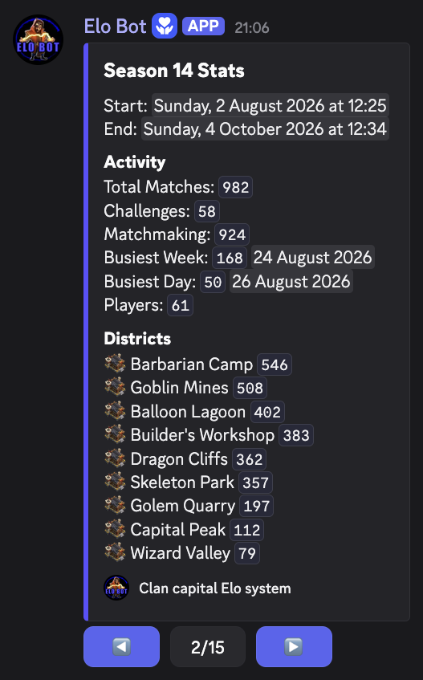

# Elo Bot

Elo Bot is a Discord bot for running competitive Clash of Clans Clan Capital matches. It brings matchmaking, ratings, match administration, and base management into the server where players organize their games.

The project combines asynchronous Discord workflows with MongoDB persistence and integrations with the Clash of Clans and Helper APIs. It also includes image-based base search and tools for managing raid weekends and tournament finals.

**Over 7,200 matches played by 377 players across 15 seasons.** *(Last updated: November 4, 2026.)*

<p align="center">
  
</p>

<p align="center">
  
  
</p>

Watch Elo matches on our collaboration YouTube channel, [SenFGr](https://www.youtube.com/@SenFGr), and in the [Clan Capital Elo playlist](https://www.youtube.com/playlist?list=PLCBSjHpUFbfGiwqK-xf1R5FdGqrFBf3rk).

## Features

- Matchmaking queues and player challenges, with match channels and result reporting.
- Elo ratings, player profiles, match history, leaderboards, and seasons.
- Base submission, storage, renewal, and image-based search.
- Raid-weekend workflows, match hosting, and Helper integration.
- Finals brackets and predictions, plus staff tools for administration and corrections.

## How it works

The bot uses `interactions.py` for Discord interactions and `coc.py` for Clash of Clans data. MongoDB stores the application state through Beanie models. The entry points initialize the services and load the extensions in `elobot/extensions/`. [ARCHITECTURE.md](ARCHITECTURE.md) describes the layers and where code goes; [COMMANDS.md](COMMANDS.md) maps every command to its handler.

| Path | Purpose |
| --- | --- |
| `main.py`, `beta.py` | Production and beta entry points (identical launchers) |
| `elobot/extensions/` | Discord commands and background workflows |
| `elobot/features/` | Domain logic: matchmaking, results, stored bases, hosting, base search, finals |
| `elobot/app/`, `elobot/config/`, `elobot/core/` | Startup, configuration and pure calculations |
| `elobot/db/` | Beanie documents and persistence models |
| `elobot/discord/`, `elobot/integrations/` | Discord helpers, Helper API, downloads |
| `scripts/` | Base-finder setup and diagnostic utilities |
| `tests/` | Automated regression tests |
| `watchdog.py` | Optional supervisor for the production process |

The base finder uses PyTorch, Ultralytics, SAHI, and OpenCV. Its model weights are included under `models/`. The model manifest records that upstream redistribution permission is unresolved; review it before distributing the weights.

## Running locally

This is a deployment-specific bot, not a turnkey Discord application. Running it requires Python 3.12, MongoDB, Discord bot credentials, and Clash of Clans API credentials. Helper-backed workflows also require access to the Helper API.

1. Create a virtual environment and install the dependencies:

   ```bash
   python3.12 -m venv .venv
   source .venv/bin/activate
   python -m pip install -r requirements.txt
   ```

   The dependency list includes machine-learning packages; installation can be substantial and PyTorch wheel selection varies by platform.

2. Copy the environment template and fill in the credentials for the deployment:

   ```bash
   cp .env.example .env
   mkdir -p data temp
   ```

   Use `BOT_MAIN_TOKEN` for the production entry point or `BOT_BETA_TOKEN` for beta. Both use `COC_API_EMAIL`, `COC_API_PASSWORD`, and `MONGO_DB_URL`. Set `HELPER_API_BASE_URL` and `HELPER_API_KEY` for Helper-backed features. Keep `.env` private.

3. Review `elobot/config/` (`ids.py`, `emojis.py`) and the command extensions for the existing server's guild, channel, role, emoji, and other deployment-specific IDs. Configure your Discord bot's permissions and intents for your server before starting it.

4. Start the desired deployment:

   ```bash
   python main.py
   # or
   python beta.py
   ```

   Production uses the `elo_bot` database and beta uses `elo_beta`. Both entry points connect to external services; they do not provide an offline mode.

For base-image search, `scripts/setup_base_finder.py` can download and verify the model specified in `elobot/features/bases/fingerprints/model_manifest.json`. Check the model's permission status before using or redistributing it.

## Tests

Run the test suite from the project root:

```bash
python -m unittest discover -v tests
```

Tests mock external services where appropriate. Running the bot itself requires service credentials and deployment configuration.
